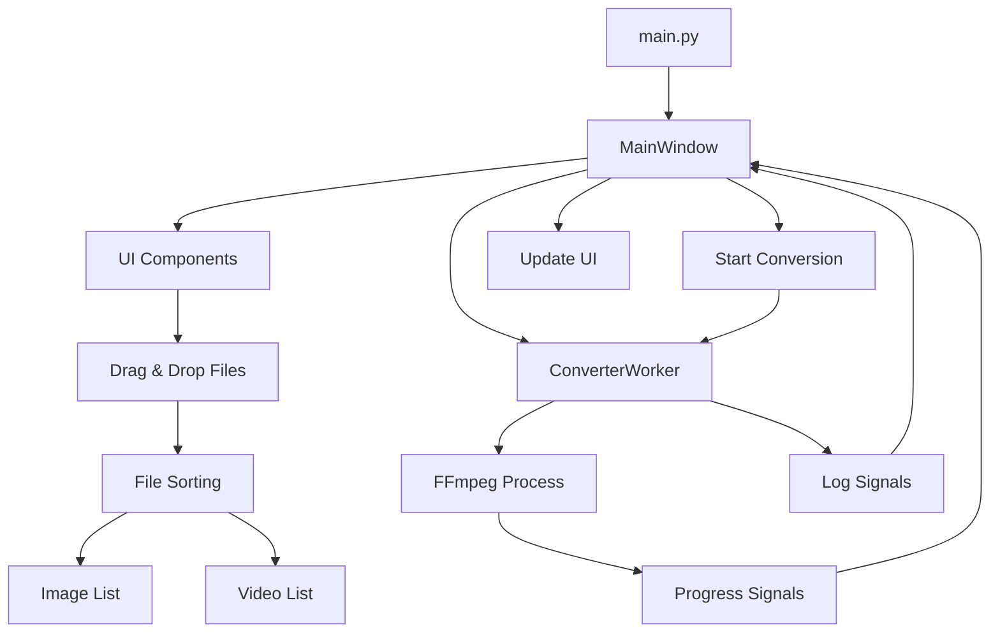
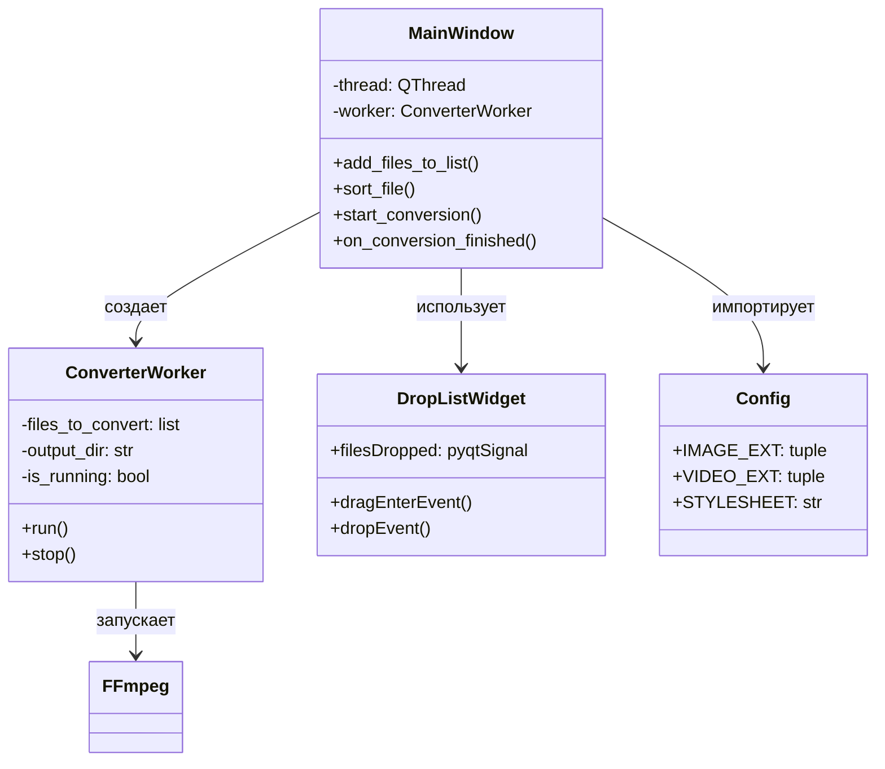
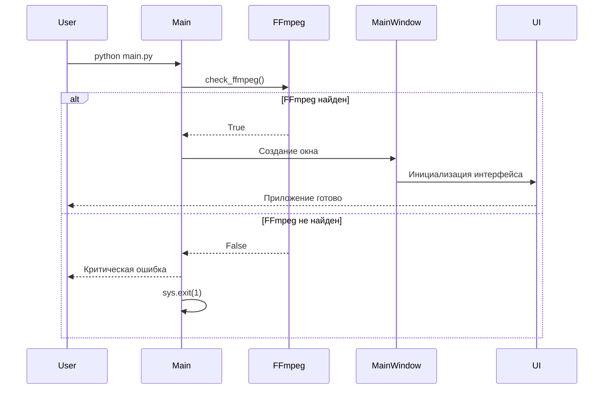

# Pro Media Converter 🎬

Быстрый и удобный конвертер медиафайлов на Python с графическим интерфейсом PyQt6 и ядром FFmpeg.

## Ключевые особенности

- 📁 **Batch processing** - массовая обработка файлов
- 🖱️ **Drag & Drop** - удобное перетаскивание файлов
- 🎯 **Умная сортировка** - автоматическое разделение фото и видео
- 🌐 **Офлайн работа** - никакого интернета не требуется
- 🔒 **Локальная обработка** - все данные остаются на вашем компьютере
- 🎨 **Современный интерфейс** - темная тема Nordic

---

## 1. Структура проекта

```
media_converter/
├── main.py                  # Точка входа приложения
├── main_window.py           # Главное окно приложения
├── ui_components.py         # UI компоненты и виджеты
├── converter_worker.py      # Логика конвертации в отдельном потоке
├── config.py               # Конфигурация и стили
└── requirements.txt        # Зависимости проекта
```

---

## 2. Описание файлов

### 📁 `main.py`
**Назначение:** Точка входа приложения и проверка системных требований

**Ключевые функции:**
- `check_ffmpeg()` - проверяет наличие FFmpeg в системе
- `main()` - инициализирует приложение и запускает главное окно

**Связи с другими файлами:**
- Импортирует `MainWindow` из `main_window.py`
- Использует PyQt6 для создания приложения

**Логика:**
Проверяет доступность FFmpeg перед запуском. Если FFmpeg не найден, показывает критическую ошибку и завершает работу. В противном случае создает и отображает главное окно.

### 📁 `main_window.py`
**Назначение:** Основное окно приложения и управление бизнес-логикой

**Ключевые функции/классы:**
- `MainWindow` - главный класс окна приложения
- `add_files_to_list()` - добавление файлов в списки
- `sort_file()` - сортировка файлов по типу (изображения/видео)
- `start_conversion()` - запуск процесса конвертации
- `on_conversion_finished()` - обработка завершения конвертации

**Связи с другими файлами:**
- Импортирует UI компоненты из `ui_components.py`
- Использует конфигурацию из `config.py`
- Создает воркера из `converter_worker.py`

**Логика:**
Управляет всем жизненным циклом приложения: обработка drag&drop, валидация файлов, настройка конвертации, создание рабочих потоков и отображение прогресса.

### 📁 `ui_components.py`
**Назначение:** Создание пользовательского интерфейса

**Ключевые функции/классы:**
- `DropListWidget` - кастомный виджет с поддержкой drag&drop
- `create_main_widget()` - создание основного интерфейса

**Связи с другими файлами:**
- Использует PyQt6 виджеты
- Подключается к методам `MainWindow`

**Логика:**
Создает весь пользовательский интерфейс: списки файлов с drag&drop, комбобоксы для выбора форматов, кнопки управления, прогресс-бар и лог вывода.

### 📁 `converter_worker.py`
**Назначение:** Конвертация файлов в отдельном потоке

**Ключевые функции/классы:**
- `ConverterWorker` - воркер для конвертации в отдельном потоке
- `run()` - основной метод конвертации
- `stop()` - остановка процесса

**Связи с другими файлами:**
- Работает независимо в QThread
- Сигналы подключены к MainWindow

**Логика:**
Выполняет конвертацию через FFmpeg в отдельном потоке, отправляя сигналы о прогрессе и логах. Поддерживает разные настройки для видео и изображений.

### 📁 `config.py`
**Назначение:** Конфигурация приложения и стили

**Ключевые константы:**
- `IMAGE_EXT` - поддерживаемые форматы изображений
- `VIDEO_EXT` - поддерживаемые форматы видео
- `STYLESHEET` - CSS стили в Nordic Dark теме

**Связи с другими файлами:**
- Импортируется в `main_window.py`

**Логика:**
Централизованное хранение настроек и стилей приложения.

### 📁 `requirements.txt`
**Назначение:** Список зависимостей проекта

**Содержимое:**
- `pyqt6` - фреймворк для GUI

---

## 3. Архитектура проекта

### Общая структура
Приложение построено по принципу разделения ответственности с использованием паттерна MVC и многопоточности.

### Потоки данных



### Архитектурная диаграмма



---

## 4. Библиотеки/фреймворки

### PyQt6
**Назначение:** GUI фреймворк для создания нативного пользовательского интерфейса

**Где используется:**
- `main.py` - QApplication для инициализации приложения
- `main_window.py` - QMainWindow, QThread для основного окна и многопоточности
- `ui_components.py` - все виджеты интерфейса
- `converter_worker.py` - QObject и pyqtSignal для воркера

### FFmpeg (внешняя зависимость)
**Назначение:** Ядро конвертации медиафайлов

**Где используется:**
- `main.py` - проверка наличия в системе
- `converter_worker.py` - выполнение конвертации через subprocess

### Python Standard Library
**Назначение:** Системные операции и обработка файлов

**Модули:**
- `os` - работа с операционной системой
- `subprocess` - запуск внешних процессов
- `pathlib` - работа с путями файлов
- `sys` - системные функции

---

## 5. Точка входа и запуск

### Как запускается проект

1. **Установка зависимостей:**
   ```bash
   pip install -r requirements.txt
   ```

2. **Проверка FFmpeg:**
   - Приложение автоматически проверяет наличие FFmpeg
   - FFmpeg должен быть доступен через системную переменную PATH

3. **Запуск:**
   ```bash
   python main.py
   ```

### Что выполняется первым



1. Проверка наличия FFmpeg в системе
2. Инициализация QApplication
3. Создание главного окна MainWindow
4. Настройка UI компонентов
5. Применение стилей
6. Отображение окна пользователю

---

## 6. Архитектурные особенности

### Нестандартные решения

#### 1. **Кастомный Drag & Drop виджет**
```python
class DropListWidget(QListWidget):
    filesDropped = pyqtSignal(list)
```
**Причина:** Стандартный QListWidget не поддерживает удобный drag&drop для файлов. Кастомная реализация позволяет перетаскивать файлы прямо из проводника.

#### 2. **Многопоточная архитектура с QThread**
```python
self.thread = QThread()
self.worker = ConverterWorker(files_to_convert, output_dir)
self.worker.moveToThread(self.thread)
```
**Причина:** FFmpeg может обрабатывать файлы долго. Использование отдельного потока предотвращает блокировку UI и позволяет показывать прогресс в реальном времени.

#### 3. **Умная сортировка файлов по типу**
```python
def sort_file(self, path, img_list, vid_list, current_imgs, current_vids):
    if path not in current_imgs and path.lower().endswith(self.IMAGE_EXT):
        img_list.append(path)
```
**Причина:** Автоматическое разделение файлов на изображения и видео упрощает пользователю работу и предотвращает ошибки при выборе неподходящих форматов.

#### 4. **Кроссплатформенные настройки subprocess**
```python
startupinfo = None
if os.name == 'nt':
    startupinfo = subprocess.STARTUPINFO()
    startupinfo.dwFlags |= subprocess.STARTF_USESHOWWINDOW
```
**Причина:** На Windows предотвращает появление консольного окна FFmpeg, обеспечивая чистый пользовательский опыт.

#### 5. **Nordic Dark тема в CSS-стиле**
**Причина:** Современный внешний вид с темной темой снижает нагрузку на глаза и выглядит профессионально. CSS-подобный синтаксис PyQt6 позволяет легко настраивать внешний вид.

### Причины выбора архитектуры

1. **PyQt6 вместо Tkinter**: Более современный и функциональный интерфейс
2. **Отдельный поток для конвертации**: Отзывчивый интерфейс во время обработки
3. **Модульная структура**: Легкость сопровождения и расширения
4. **Сигналы и слоты**: Слабая связанность между компонентами
5. **Централизованная конфигурация**: Простота изменения настроек

---

## 7. Системные требования

- **Python 3.7+**
- **FFmpeg** (должен быть доступен в PATH)
- **PyQt6**
- **Операционная система:** Windows, macOS, Linux

---

## 8. Поддерживаемые форматы

### Входные форматы
- **Изображения:** PNG, JPG, JPEG, BMP, WebP, TIFF, GIF, TIF
- **Видео:** MP4, MKV, AVI, MOV, FLV, WebM, WMV, MPG

### Выходные форматы
- **Изображения:** PNG, JPG, WebP, BMP
- **Видео:** MP4, MKV, WebM, AVI, MOV

---

## 9. Использование

1. Запустите приложение
2. Перетащите файлы в соответствующие области (изображения/видео)
3. Выберите выходные форматы
4. Укажите папку для сохранения
5. Нажмите "🚀 Конвертировать"
6. Следите за прогрессом в нижней панели

---

Автор: legenda  
Telegram: [@LEGENDA_SD](https://t.me/LEGENDA_SD)
